<div align="center">


# AntCloud for Android

**Your AntCloud gaming PC, one tap away on your Android phone.**<br>
Sign in, start the cloud PC, watch it boot, and play. Pairing happens on its own.

<p>
  <a href="https://github.com/Sammy970/AntCloudAndroid/releases/latest"></a>
  
  
  
  
</p>

<p><a href="#download"><b>Download</b></a> &nbsp;·&nbsp; <a href="#the-whole-session-on-one-screen">Screenshots</a> &nbsp;·&nbsp; <a href="#how-it-works">How it works</a> &nbsp;·&nbsp; <a href="#building-it-yourself">Build</a> &nbsp;·&nbsp; <a href="#project-layout">Project layout</a> &nbsp;·&nbsp; <a href="#made-by">Made by</a></p>

<p>
  <a href="https://discord.gg/GVDYtpWHps"></a><br>
  <b>Need help, found a bug, or have an idea?</b> Join the community: get help, report bugs and suggest features for AntCloud.
</p>

</div>

> [!IMPORTANT]
> **Unofficial project.** This is an independent client built by a user. It is not made, endorsed or supported by AntCloud.
> "AntCloud" and the AntCloud logo belong to their owners. Use it with your own AntCloud account, and follow AntCloud's terms of service.

> [!NOTE]
> **Early preview.** It's tested end to end on the Android emulator: sign-in, starting the cloud PC, pairing and streaming. It hasn't had much time on real phones yet, so if something breaks, please [open an issue](https://github.com/Sammy970/AntCloudAndroid/issues).

This is a fork of [Moonlight for Android](https://github.com/moonlight-stream/moonlight-android) with an AntCloud panel added in front of it, the same approach as [AntCloud for iPhone](https://github.com/Sammy970/AntCloudMoonlight). Moonlight does the streaming, unchanged; the panel signs you in, runs your cloud PC session and hands Moonlight everything it needs.

<br>

<table>
  <tr>
    <td width="50%"><picture><source media="(prefers-color-scheme: dark)" srcset=".github/screenshots/dark-login.png">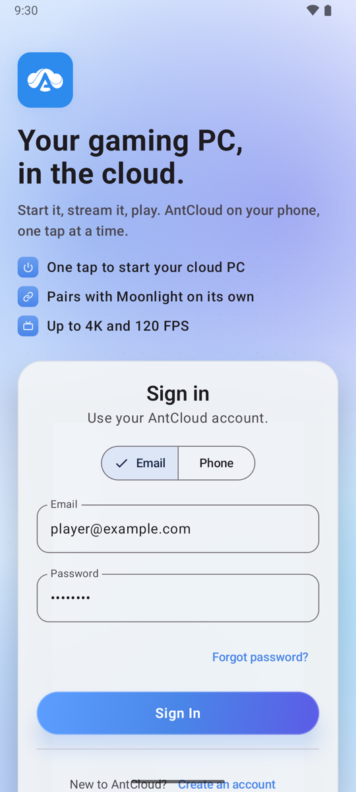</picture></td>
    <td width="50%"><picture><source media="(prefers-color-scheme: dark)" srcset=".github/screenshots/dark-step-ready.png">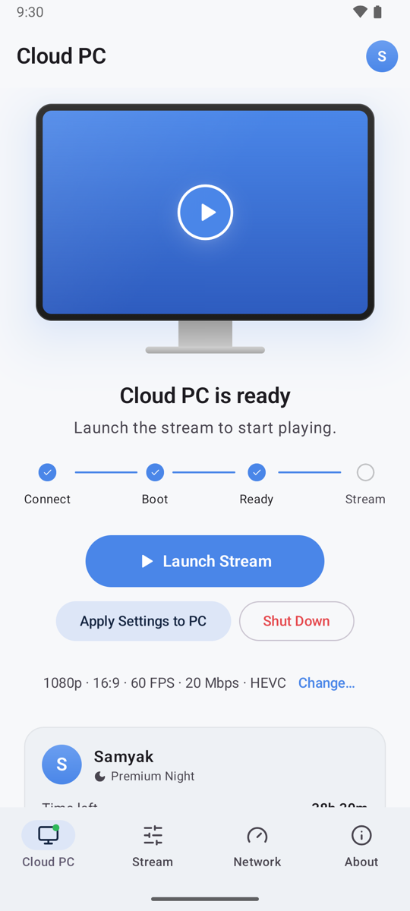</picture></td>
  </tr>
</table>

## The whole session on one screen

The Cloud PC screen is built around one question: what is my cloud PC doing right now?
A drawn monitor shows the answer, the track below it shows how far along you are, and there is only ever one main button.

<table>
  <tr>
    <td width="33%" valign="top">
      <picture><source media="(prefers-color-scheme: dark)" srcset=".github/screenshots/dark-step-idle.png">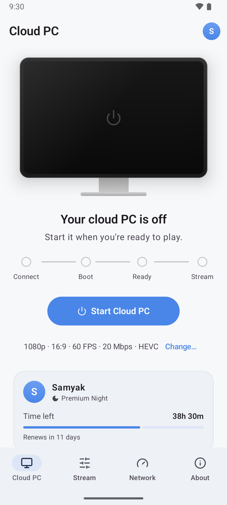</picture>
      <p align="center"><b>Off</b><br><sub>One tap to start.</sub></p>
    </td>
    <td width="33%" valign="top">
      <picture><source media="(prefers-color-scheme: dark)" srcset=".github/screenshots/dark-step-queued.png">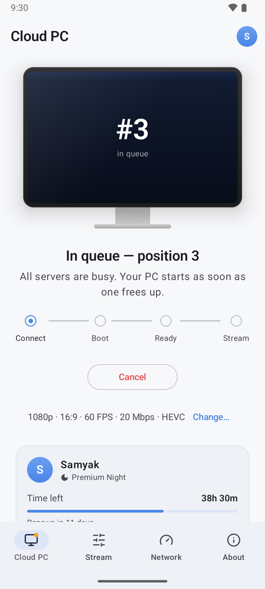</picture>
      <p align="center"><b>In the queue</b><br><sub>Your live position while servers are busy.</sub></p>
    </td>
    <td width="33%" valign="top">
      <picture><source media="(prefers-color-scheme: dark)" srcset=".github/screenshots/dark-step-booting.png">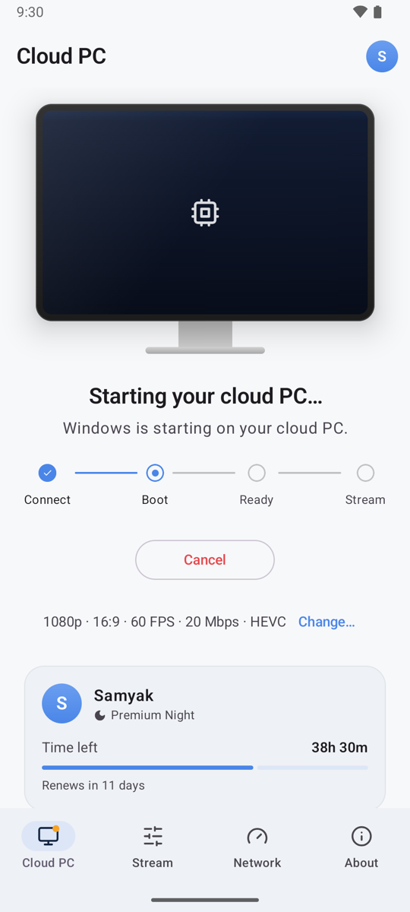</picture>
      <p align="center"><b>Booting</b><br><sub>Windows starts on the cloud PC.</sub></p>
    </td>
  </tr>
  <tr>
    <td width="33%" valign="top">
      <picture><source media="(prefers-color-scheme: dark)" srcset=".github/screenshots/dark-step-ready.png"></picture>
      <p align="center"><b>Ready</b><br><sub>Launch the stream when you are.</sub></p>
    </td>
    <td width="33%" valign="top">
      <picture><source media="(prefers-color-scheme: dark)" srcset=".github/screenshots/dark-step-pairing.png">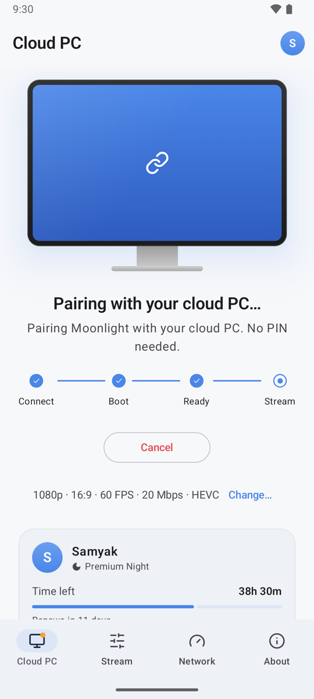</picture>
      <p align="center"><b>Pairing</b><br><sub>Moonlight pairs itself. No PIN to type.</sub></p>
    </td>
    <td width="33%" valign="top">
      <picture><source media="(prefers-color-scheme: dark)" srcset=".github/screenshots/dark-step-streaming.png">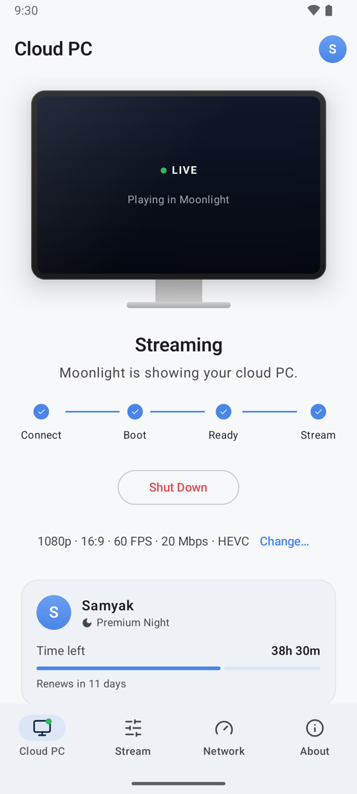</picture>
      <p align="center"><b>Streaming</b><br><sub>Back here when the stream closes; the PC keeps running.</sub></p>
    </td>
  </tr>
</table>

## Settings, a network check and clear messages

<table>
  <tr>
    <td width="33%" valign="top">
      <picture><source media="(prefers-color-scheme: dark)" srcset=".github/screenshots/dark-settings.png">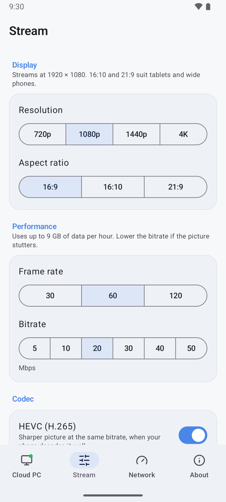</picture>
      <p align="center"><b>Stream settings</b><br><sub>720p to 4K, 16:9, 16:10 or 21:9, 30 to 120 FPS, 5 to 50 Mbps and HEVC, with the exact stream size and data use.</sub></p>
    </td>
    <td width="33%" valign="top">
      <picture><source media="(prefers-color-scheme: dark)" srcset=".github/screenshots/dark-network.png">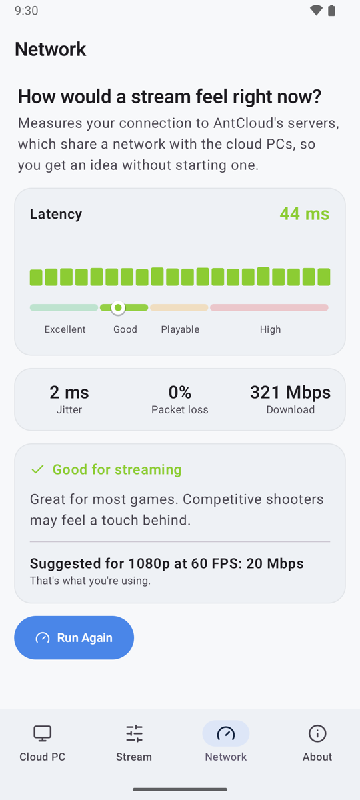</picture>
      <p align="center"><b>Network check</b><br><sub>How a stream would feel, without starting the PC: latency, jitter, loss, speed and the bitrate to use.</sub></p>
    </td>
    <td width="33%" valign="top">
      <picture><source media="(prefers-color-scheme: dark)" srcset=".github/screenshots/dark-notice.png">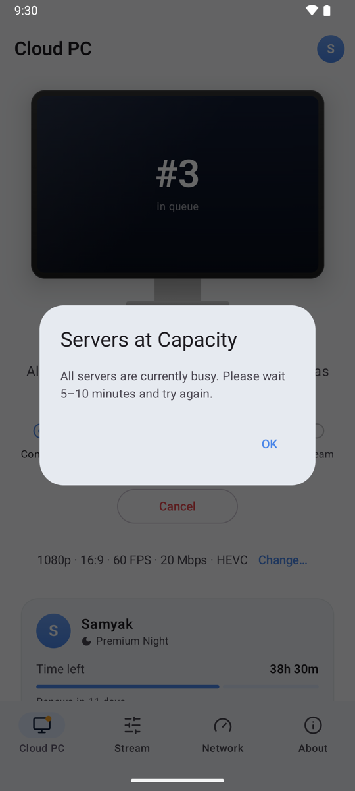</picture>
      <p align="center"><b>Plain messages</b><br><sub>Every reason AntCloud stops a session gets a sentence saying what happened and what to do.</sub></p>
    </td>
  </tr>
</table>

Settings lock while you're streaming. The app follows your phone's light or dark mode; AntCloud blue is the only accent colour.

## Check your controller

<table>
  <tr>
    <td width="40%" valign="top">
      <picture><source media="(prefers-color-scheme: dark)" srcset=".github/screenshots/dark-controllers.png">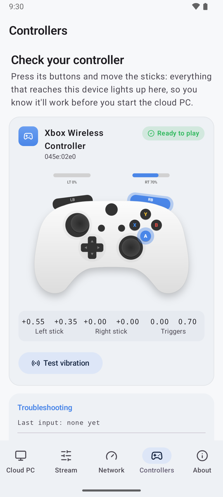</picture>
    </td>
    <td width="60%" valign="top">
      <p>The <b>Controllers</b> tab shows whether a controller will work before you start the cloud PC.</p>
      <ul>
        <li><b>A drawn controller that mirrors yours:</b> buttons light up as you press them, the sticks move with yours and the triggers fill as you pull them. Labels follow the controller: A B X Y, or ✕ ○ □ △ on PlayStation.</li>
        <li><b>Ready to play, or not:</b> the same test Moonlight uses when a stream starts, with what to try if a controller won't be sent to the cloud PC.</li>
        <li><b>Troubleshooting:</b> exact stick and trigger values, a vibration test, and a diagnostics report to share if a controller doesn't work.</li>
      </ul>
    </td>
  </tr>
</table>

## Glass on-screen controls, placed where you want them

<table>
  <tr>
    <td width="50%">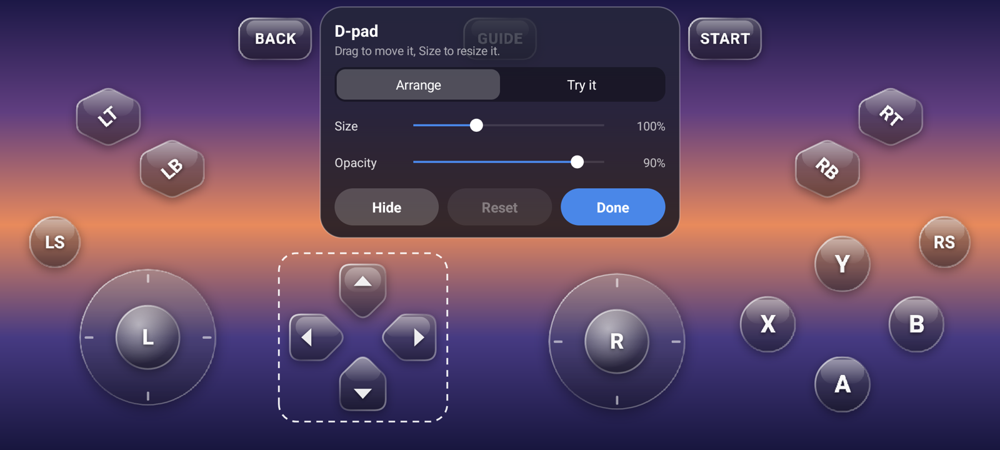</td>
    <td width="50%">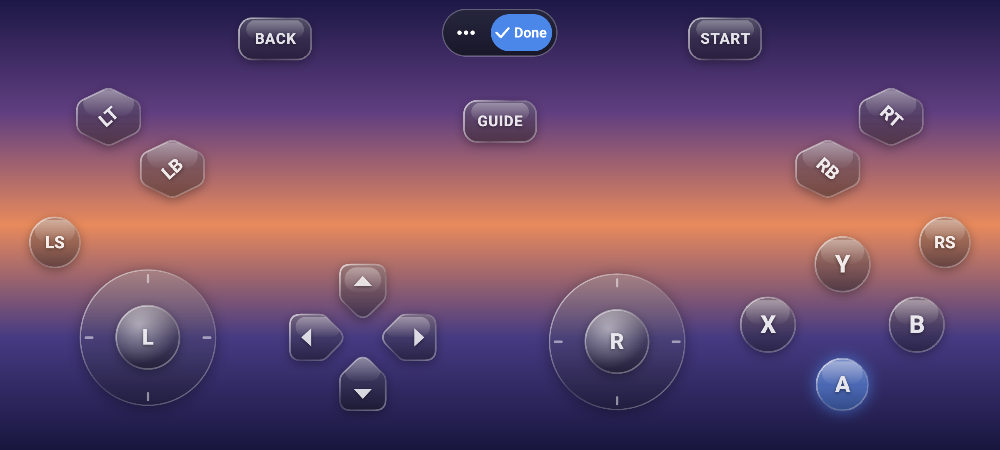</td>
  </tr>
</table>

The touch gamepad is drawn as smoky glass: an A B X Y diamond, a D-pad made of four separate pieces, tilted LT, LB, RT and RB buttons,
Back and Start pills, LS and RS buttons and big stick rings. Pressed buttons light up AntCloud blue.

- **Move and resize:** drag any control, then use **Size** to make it bigger or smaller. Guide lines help you line things up.
- **Hide and fade:** hide the controls you don't use and set how see-through the whole gamepad is.
- **Try it:** press the controls to see how they react. Nothing is sent to the cloud PC.
- **Where:** Settings → Stream → **Customize on-screen controls** (no cloud PC needed), or the gear button at the top-left during a stream.

## Features

- **Sign in** with email and password or a phone code. The refresh token is encrypted with a key that stays in the Android Keystore.
- **One-tap cloud PC.** Handles the queue, the boot and the readiness checks.
- **Automatic pairing.** The app makes up the PIN, pairs Moonlight with it and hands the same PIN to AntCloud, so Sunshine on the cloud PC accepts it. Nothing to type.
- **Your settings, applied for you.** Resolution, aspect ratio, frame rate, bitrate and codec are written into Moonlight before each stream, and sent to the cloud PC so its display matches.
- **Your plan on the home screen.** Time left this month, the renewal date and a readable plan name, like "Premium Night".
- **Night-plan aware.** Checks the server clock before starting, so outside 12:30–9:30 AM IST it tells you
  instead of booting the PC, and ends the session at the plan's cutoff like the official client.
- **Network check** without starting the cloud PC, with a verdict and a bitrate suggestion for your settings.
- **Typing during a stream:** a keyboard button in the corner of the stream opens your phone's keyboard (a three-finger tap does too).
- **Controller check** (the Controllers tab): a drawn controller mirrors every press, stick and trigger live, says whether the cloud PC
  will get it as a controller, and has a vibration test. If a controller doesn't work, it can share a diagnostics report with Moonlight's
  log, and Moonlight's own controller settings are one tap away.
- **Glass on-screen controls** you can move, resize, hide and fade, with a Try it mode.
- **Motion with a purpose:** the monitor powers on, the track fills step by step, and a failed sign-in shakes.

## Download

**[Download AntCloud for Android](https://github.com/Sammy970/AntCloudAndroid/releases/latest)**: no building needed.

1. On your phone, download `AntCloud-<version>.apk` from the latest release.
2. Open it. Android asks to allow installs from your browser or file manager the first time; allow it and tap **Install**.
3. Open **AntCloud** and sign in.

Needs Android 6.0 or later. It installs alongside Moonlight if you have it, and keeps its own pairings.

## How it works

```
Sign in ──▶ Start Cloud PC ──▶ queue ──▶ boot ──▶ ready
                                                    │
                                              Launch Stream
                                                    │
                     get VM address ──▶ pair (auto PIN) ──▶ Moonlight stream screen
```

1. A Socket.IO session queues and boots your cloud PC, and reports each step.
2. The app polls until the PC is reachable, then tells the server to start video.
3. **Launch Stream** fetches the PC's address and adds it to Moonlight, pairs if needed through Moonlight's own pairing code, copies your settings into Moonlight and opens its stream screen on the cloud PC's **Desktop**.
4. When the stream closes you're back on the Cloud PC screen, with the PC still running until you shut it down.

## When AntCloud changes things

AntCloud has no public API; this app uses the one its own Windows app uses, and that can change without notice.
On 30 Oct 2026 their Windows app 0.016 renamed every route, and sign-in stopped working. So:

- **At launch**, a banner appears when AntCloud ships a newer Windows app than the one this code matches.
- **When a route disappears**, the app says AntCloud changed their service instead of showing a bare error.

## Building it yourself

You need JDK 17 and the Android SDK with NDK 29.0.14206865 (Moonlight's streaming core is C).

```sh
git clone --recurse-submodules https://github.com/Sammy970/AntCloudAndroid.git
cd AntCloudAndroid
echo "sdk.dir=$HOME/Library/Android/sdk" > local.properties   # wherever your SDK is
./gradlew :app:assembleNonRootDebug                            # → app/build/outputs/apk/nonRoot/debug/
```

Release builds are signed with a key read from `~/.android/antcloud-release.properties` (`storeFile`, `storePassword`, `keyAlias`, `keyPassword`); without that file they build unsigned.

<details>
<summary><b>Preview mode</b>, for working on the UI</summary>
<br>

Any screen can be opened with a sample account, without touching your stored sign-in or the API.
This is how the screenshots above were made.

```sh
adb shell am start -S -n com.samyakjain.antcloud.debug/co.antcloud.ui.AntCloudActivity \
  --es preview home:ready:stream --es theme dark
```

| Extra | Values |
|---|---|
| `preview` | `login`, `home:idle`, `home:queued`, `home:booting`, `home:ready`, `home:pairing`, `home:streaming`. Add `:stream`, `:network`, `:controllers`, `:about`, `:notice` or `:upstream`, and `:sample` for a sample controller. |
| `theme` | `light` or `dark` |

The network preview shows sample results, since the emulator's virtual network adds hundreds of milliseconds to a real run.

</details>

## Project layout

Everything AntCloud adds is in `co.antcloud`; the rest is Moonlight 12.2, changed only where noted with `AntCloud:` comments
(the app ID, the launcher activity, the version and the build setup).

| Path | What's there |
|---|---|
| `app/src/main/java/co/antcloud/api/` | API client, profile, the "AntCloud changed something" check |
| `app/src/main/java/co/antcloud/auth/` | Sign-in and the Keystore-encrypted refresh token |
| `app/src/main/java/co/antcloud/session/` | Socket.IO session, stream settings, network check |
| `app/src/main/java/co/antcloud/stream/` | `MoonlightBridge`: adding the host, pairing and starting the stream |
| `app/src/main/java/co/antcloud/ui/` | The Compose screens, the drawn monitor and connection track |
| `README-moonlight.md` | Moonlight's own README |

Logs go to logcat (`adb logcat -s AntCloud`) and to `antcloud.log` in the app's files.

## Made by

<table>
  <tr>
    <td width="96" valign="middle"><a href="https://github.com/Sammy970"></a></td>
    <td valign="middle">
      <b>Samyak Jain</b><br>
      <sub>Designed and built AntCloud for Android, iPhone, Mac and Windows, from reverse-engineering AntCloud's Windows app to the last animation.</sub><br><br>
      <a href="https://github.com/Sammy970"></a>
      <a href="https://x.com/Sammy_970"></a>
    </td>
  </tr>
</table>

Also available: [for iPhone](https://github.com/Sammy970/AntCloudMoonlight), [for Mac](https://github.com/Sammy970/AntCloudMac) and [for Windows](https://github.com/Sammy970/AntCloudWin). If this helped you play, a ⭐ on the repo or a hello on X is always welcome.

<p align="center">
  <picture><source media="(prefers-color-scheme: dark)" srcset=".github/screenshots/dark-about.png">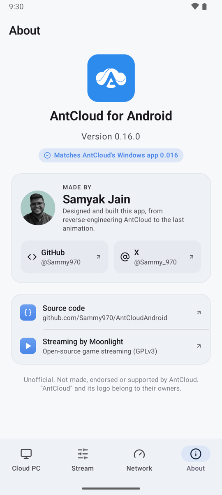</picture>
  <br><sub>The same credits live in the app, under <b>About</b>.</sub>
</p>

## Versioning

`0.<AntCloud release>.<ours>`: **0.16.x** works with AntCloud's Windows app **0.016**. The middle number moves when
AntCloud changes its API and this app catches up (0.17.0 for their 0.017); the last one counts our own releases.
It's set in `Config.APP_VERSION` and `versionName` in `app/build.gradle`.

## License

GPLv3, like Moonlight, which this is built on: see [LICENSE.txt](LICENSE.txt). Streaming by
[Moonlight](https://moonlight-stream.org). Not affiliated with AntCloud or the Moonlight project.
